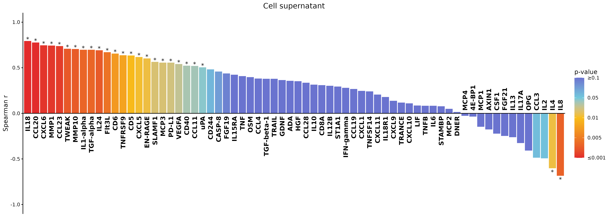
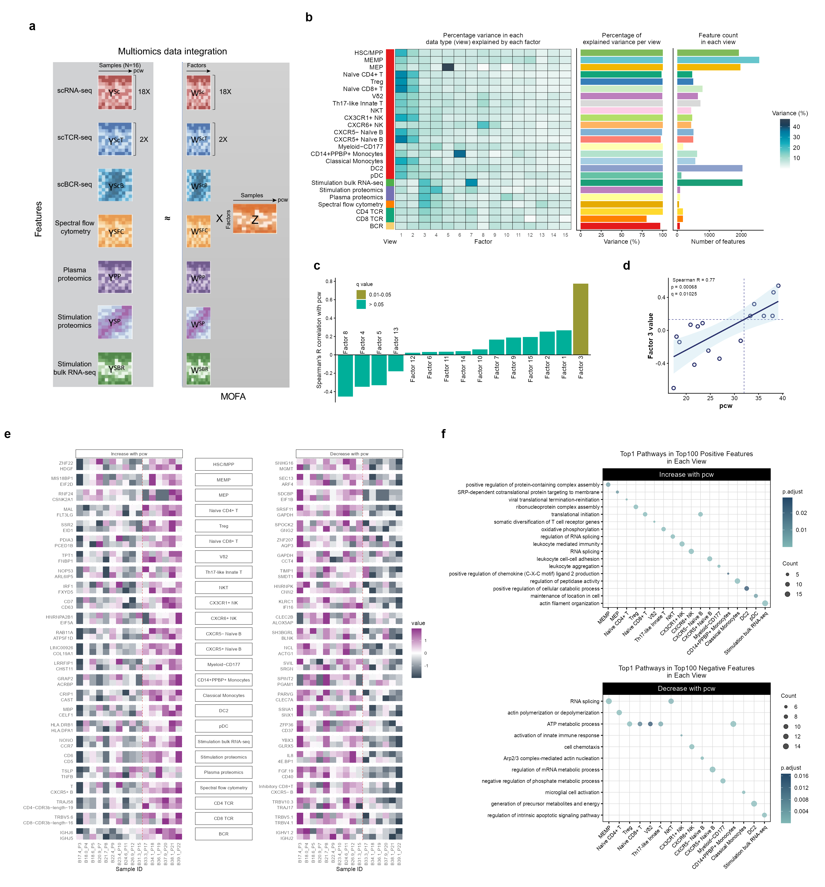

# 胎儿血项目的科学主线：出生前的免疫应答能力怎样形成

> 科学问题：胎儿血中的细胞、识别工具和调节机制，怎样随发育组合起来，形成不同的免疫应答能力？
>
> 当前最需要接上的一环：把血液中细胞组成和细胞自身状态的变化，连接到同一样本的刺激后应答。

本分析依据仓库已有图表、分析说明和公开原始研究，按 mao_paperthinking 的“科学界尚未解释的问题 → 当前关键缺口 → 证据推动下一问”组织。核对日期为 2026-10-12，项目结果基线为提交 `f9b32bf`。下文明确区分已有结果与后续研究设计；后续设计尚待执行。

## 一、科学界已经知道什么，还需要解释什么

胎儿时期已经存在多类免疫细胞，也已经发生识别受体的建立、细胞状态分化和免疫调节。早期多器官图谱描绘了这些细胞在不同组织中的分布与发育过程；受体研究也发现了随胎儿发育发生的受体谱变化。因此，“胎儿有没有免疫系统”“受体会不会随年龄改变”，已经有直接研究基础。[1,2]

更近的研究把问题向前推进了。胎儿调节性 T 细胞的功能与稳定性具有自身特点；2025 年的跨器官研究还观察到广泛的免疫活性，并研究了约束这种活性的机制。胎儿免疫同时具有应答和调节能力，这一点已有实验证据。[3,4]

**真正值得本项目继续回答的是：这些已经存在的能力，在妊娠推进过程中怎样组合成血液里的功能系统？** 某一类细胞更多、某一组基因更活跃、某一种受体结构更复杂，各自提供了一部分信息。它们怎样共同对应一次实际刺激后的输出，仍然需要在明确的发育时间范围、同一血液场景和相互对应的样本中建立联系。

这个问题里有一个关键张力：我们能够越来越细地描述胎儿血“有什么”，对这些成分怎样共同决定“遇到刺激时会怎样反应”，解释仍然不足。例如，同样观察到刺激后某些蛋白升高，可能是产生它的细胞更多，也可能是每个细胞的反应状态发生改变，还可能是其他细胞提供的支持发生改变。三种解释对应不同的发育过程。

本项目约 12–39 受孕后周的血液样本，以及静息细胞、受体、流式、血浆和刺激后测量，为连接这两端提供了机会。这里的科学定位建立在本轮核对的文献和项目材料上；“首次”和“填补空白”等优先权判断还需专门的系统检索。

## 二、我们的主要矛盾是什么

**项目已经有多层随年龄变化的结果，最关键的缺口是：哪些变化与实际应答方式有关，它们各自怎样贡献？**

现有图已经能够回答血液里有哪些细胞、哪些比例变化、哪些细胞程序变化、受体谱怎样改变、哪些刺激后蛋白与年龄相关。把这些结果依次展示，读者可以认识一个发育中的系统。要进一步解释这个系统，就需要接上一句话：血液中的哪些变化，对应了它后来呈现的哪一种应答方式。

当前最值得投入的是这条“细胞与状态 → 应答输出”的连接。多组学因子可以帮助概括变化，受体谱可以补充识别能力的发育维度，细胞通讯推断可以提供候选解释。每一部分都应有清楚的科学职责。

一个可检验的工作假说是：**胎儿血应答方式的发育，同时受到细胞组成重排和同类细胞内部状态改变的影响；不同应答程序获得这些支持的时间可能不同。** 这是后续要检验的解释。现有证据已经支持多层年龄相关变化，组成、内在状态和细胞合作的贡献还需要进一步区分。

“出生准备”可以成为研究的远景。当前样本与终点对妊娠期血液发育提供了直接证据；出生后防御效果、感染风险和新生儿结局，需要对应的临床观察继续连接。

## 三、第一层：血液里的参与者怎样变化

先问一个具体问题：**随发育推进，血液的细胞构成发生了哪些足以影响功能的变化？**

[Figure 1](../Main_Figure_01) 给出细胞地图和组织背景，[Figure 2](../Main_Figure_02) 描述随年龄变化的细胞组成与程序，[Figure 6](../Main_Figure_06) 提供流式测量。这三部分共同建立功能解释的起点。肝、胸腺、脾等组织资料有助于理解细胞身份和来源背景，血液中的年龄变化承担主线。

已有结果中，部分造血祖细胞减少，Vδ1 T 细胞和经典单核细胞随年龄增加。这样的变化意味着不同功能参与者在血液里的份额重新分配。Treg、Vδ2 等下降方向也值得保留，但各群的证据强度有差别；“某群比例下降”与“其功能减弱”需要分别判断。尤其是 Treg，已有胎儿研究提示其抑制功能还与细胞状态和稳定性有关。[3]

这一层回答之后，下一问自然出现：**晚期血液与早期血液表现不同，有多少来自细胞构成，有多少来自同一种细胞本身发生变化？**

这时再进入同类细胞内部的表达程序就有了明确用途。例如，单核细胞的分化相关程序与后续细胞因子相关程序，是否对应不同的功能准备状态。每个程序都需要回到一个具体能力，例如识别、信号传递、分泌或迁移；多个通路名称本身还不足以解释功能。

## 四、第二层：识别工具与应答状态分别怎样准备

**细胞到位之后，它具备了哪些可以调用的能力？**

[Figure 4](../Main_Figure_04) 和 [Figure 5](../Main_Figure_05) 描述 TCR、BCR 的结构与克隆谱变化，回答识别工具怎样建立和扩展。已有结果包括部分 CDR3 长度与 受体谱多样性的年龄相关变化、较少的共享克隆，以及以 IgM 为主的 BCR。受体发育已有文献基础，本项目的价值在于将它放入这批血液样本的整体发育背景。[2]

这些结果支持识别潜力的变化。识别某种抗原的效果、应答幅度和保护作用，需要相应的功能证据。CDR3 更长并不能单独定义更好的抗原识别。

同类细胞的转录程序则提供另一种信息：细胞是否处于能够执行某项任务的状态。受体谱与细胞内程序可以形成互补解释，但两者各有对应的功能终点。

这一点对本项目尤其重要：现有 PHA 刺激主要提供有丝分裂原刺激条件下的应答窗口。该测量与特定抗原的识别能力之间，还隔着一层证据。受体多样性可以作为发育维度保留；若进一步讨论抗原识别范围，就需要匹配的抗原特异性测量。

下一问随之变得明确：**这些静息状态上的准备，在刺激后的输出中体现为什么？**

## 五、第三层：实际应答究竟怎样变化

[Figure 7](../Main_Figure_07) 是本项目连接功能的关键位置。现有 PHA 刺激后蛋白数据呈现不同方向的年龄相关变化：IL-18、CCL20 等随年龄升高，IL-4、IL-8 等随年龄下降。应答谱在重新分配，单一“强弱”刻度难以概括这些变化。

*图 1｜项目已有 Figure 7c。纵向排列的蛋白对应横向的年龄相关系数。两种方向同时出现，是把问题收紧到“应答方式怎样重组”的直接依据。*

读这张图时，最有价值的追问是：**哪些共同变化的输出代表同一类生物学任务，这类任务由哪些细胞承担？** 例如，趋化相关输出与其他细胞因子输出的变化是否代表不同的动员方式。具体程序的命名，需要结合蛋白来源、已知功能和配套 RNA 结果确认。

这里还应保留测量本身的含义。当前核对的表主要记录刺激后的终点水平；若要描述“刺激带来的净增量”，需要核对同培养条件下对应的未刺激对照。血浆蛋白描绘体内环境，培养上清描绘实验刺激后的输出，两个场景各有意义。静息单细胞与刺激后 bulk RNA 也需要依据测量条件建立对应关系。

因此，当前可以成立的表述是：**胎儿血在不同发育阶段呈现不同的刺激后应答谱。** 进一步解释这些差异的来源，是下一层的中心任务。

## 六、第四层：接上细胞变化与应答变化

这一层决定项目能否从“发育图谱”进一步走向“发育解释”。

第一步，把具有多模态资料的同一样本接起来。以现有 16 个完整多组学样本为起点，逐一核对静息细胞组成、同类细胞状态、刺激后蛋白及 RNA 的对应关系。样本对应表是完成这一步的工具，科学目标是让同一个胎儿血样本的“准备状态”和“应答输出”能够相互解释。

第二步，从 Figure 7 选择一个证据连贯、细胞来源可追踪的应答程序。候选可以从 IL-18、CCL20 等随年龄变化的输出展开，但最终选择应同时考虑配套 RNA 和细胞表达资料，保留最有支持的一条生物学主线。例如，若某组动员相关输出具有共同变化，就追问它与相关细胞的数量、内在状态以及辅助细胞状态分别有什么关系。

第三步，按证据区分三个解释。若输出变化主要跟随某类细胞的份额，就优先研究细胞组成重排的作用；若在构成相近的条件下，同类细胞状态仍对应输出差异，就优先研究细胞内在成熟；若单独细胞的状态解释不足、特定伙伴共同出现时输出才不同，就把细胞间合作列为重点假说。

这三种情况使后续实验具有方向。组成解释需要比较细胞配比与整体输出；内在成熟解释需要比较相应细胞的反应能力；合作解释需要改变伙伴或候选支持信号，并观察同一个功能终点。具体选择由上述连接结果推动。

[Figure 3](../Main_Figure_03) 的通讯推断可以在合作假说中提供候选分子。表达层面的配体与受体匹配，提示潜在联系；真实接触、信号传递及其对输出的贡献，还需相应的功能观察。

这一层最有价值的最终句式是：“某类细胞的某种变化，对应某项应答的改变；进一步改变这项细胞条件，能够改变同一个应答终点。” 前半句可由现有资料推进，后半句需要功能验证。两部分完成后，主线就获得了明确的解释力。

## 七、第五层：这些能力按什么节奏组合起来

前面已经知道哪些能力在变化、它们与输出怎样关联，最后再问：**这些变化是否共享一个发育节奏，哪些部分提前，哪些部分较晚？**

[Figure 8](../Main_Figure_08) 的 MOFA 整合适合回答这一层。当前模型包含 16 个样本、7 类模态、25 个数据视图。Factor 3 与年龄相关，提供了跨模态共同变化的摘要；各视图的贡献和细胞程序有所差别，值得进一步理解它们的发育节奏。

*图 2｜项目已有 Figure 8。b、e 展示不同视图的贡献与特征，c、d 展示因子与年龄的关系，f 提供对应功能注释。阅读重点是共同变化及其组成。*

这张图目前能够支持年龄相关的多模态变化。d 面板使用线性拟合，面板说明将 32 pcw 标为参考线；仓库原有概要图则使用约 31 pcw 的表述。明确的“转换时点”需要独立证据支持。当前应把 31–32 pcw 视为待检验的时间窗口，不宜据此断言统一的功能开关已经被找到。既往人类初始 T 细胞研究也提示发育可呈连续变化，并存在个体差异。[5]

整合因子还需要承担适合它的任务。Factor 3 汇集多个视图的共同变化，并未直接给出谁驱动谁。若用它连接刺激后应答，应先用静息信息定义发育状态，再考察留出的刺激测量；刺激结果本身已经参与建模时，二者的相关性含有共享输入的贡献。

最终值得争取的解释是：不同功能部件以各自的节奏发展，其中某些组合与特定应答能力的形成相联系。精确时间阈值、出生后保护作用及临床结局，可以在这一基础上继续研究。pcw 表示受孕后年龄，与临床常用的产科孕周口径不同，临床对照时需要统一时间定义。

## 八、现有每组图在主线里的职责

| 现有证据 | 它回答的科学问题 | 它推动的下一问 |
|---|---|---|
| [Fig. 1](../Main_Figure_01) | 胎儿血有哪些细胞，组织背景是什么？ | 发育时哪些参与者发生变化？ |
| [Fig. 2、6](../Main_Figure_02) / [流式](../Main_Figure_06) | 细胞比例与同类细胞状态怎样改变？ | 哪些变化可能影响具体功能？ |
| [Fig. 4、5](../Main_Figure_04) / [BCR](../Main_Figure_05) | 识别受体的结构和克隆谱怎样建立？ | 识别潜力与其他功能准备如何配合？ |
| [Fig. 7、S16–17](../Main_Figure_07) / [S16](../Supplementary_Figures/Supplementary_Figure_16) / [S17](../Supplementary_Figures/Supplementary_Figure_17) | 实验刺激后的应答方式怎样随年龄变化？ | 哪些细胞及状态可以解释这些输出？ |
| [Fig. 3、S8–9](../Main_Figure_03) / [S8](../Supplementary_Figures/Supplementary_Figure_08) / [S9](../Supplementary_Figures/Supplementary_Figure_09) | 哪些潜在细胞联系值得作为合作假说？ | 改变相应联系是否影响功能终点？ |
| [Fig. 8、S18](../Main_Figure_08) / [S18](../Supplementary_Figures/Supplementary_Figure_18) | 哪些变化具有共同发育节奏？ | 这些组合是否对应特定应答能力？ |

这张表给出科学叙事顺序，保留仓库现有图号。实际写作时，应让每段结果先回答上一段留下的问题，再引出下一段要解决的问题。

## 九、当前结论、下一阶段目标与完成标准

**当前结论：** 胎儿血的细胞组成、细胞程序、识别受体和刺激后应答谱，随发育呈现多层变化；多组学整合揭示其中的共同年龄相关信息。应答输出包含不同变化方向，支持研究应答方式的重组。

**下一阶段目标：** 从一个有一致证据的应答程序出发，将同一样本的静息细胞组成和状态与该程序连接起来，明确最值得验证的贡献来源。

**完成标准：** 能够说清楚哪项应答在变、哪些细胞条件与它对应、现有证据更支持哪一种解释，并据此提出一个能够区分关键解释的功能比较。届时再决定是否扩展到其他程序或精确时间窗口。

可用于项目讨论的一段话：

> 胎儿在出生前已经具备免疫细胞和一定的应答能力。我们想知道，这些能力在血液里怎样一步步组合起来。现有结果显示，细胞构成在变，同类细胞的状态在变，刺激后的输出也有升有降。项目下一步最重要的事，是把同一样本的这些变化接起来，找到哪些细胞条件对应哪种应答方式，再通过功能比较解释它们的贡献。

## English summary

Fetal immune activity, repertoire development and regulatory mechanisms are already supported by prior studies. This project can address how circulating cell composition and cell-intrinsic states develop alongside distinct stimulation-response programs across gestation. The central next step is to connect baseline cellular features with matched response outputs and distinguish contributions from cellular composition, intrinsic state and cellular cooperation. Current MOFA results summarize age-associated covariation; a discrete developmental switch and its clinical consequences remain hypotheses requiring further evidence.

## 证据入口与参考文献

项目证据入口：[样本及共享数据说明](../00_Global_Data/README.md)、[细胞比例结果表](../00_Global_Data/Shared_Inputs/Main_Figure_02/b_M02b/03_PlotData/M02b_PBMC_age_correlations_statistics.csv)、[刺激后蛋白结果表](../00_Global_Data/Shared_Inputs/Main_Figure_07/c_M07c/03_PlotData/M07c_Stimulated_Olink_spearman_plot_data.csv)、[MOFA 分析说明](../Main_Figure_08/00_MOFA_Analysis/README.md)、[年龄关联面板说明](../Main_Figure_08/d_M08d/01_Code/README.md)。

1. Suo C, et al. **Mapping the developing human immune system across organs.** Science, 2022. [原始论文](https://pmc.ncbi.nlm.nih.gov/articles/PMC7612819/)。提供早期跨器官免疫发育图谱，是本项目讨论细胞和组织背景的已有基础。
2. Rechavi E, et al. **Timely and spatially regulated maturation of B and T cell repertoire during human fetal development.** Science Translational Medicine, 2015. [原始论文 DOI](https://doi.org/10.1126/scitranslmed.aaa0072)。说明胎儿受体谱发育已有直接研究。
3. Leong JY, et al. **Epigenetic instability and hypofunctionality of fetal Tregs allow a permissive regulatory environment for T effector memory maturation.** PNAS, 2025. [原始论文](https://pubmed.ncbi.nlm.nih.gov/40705427/)。支持结合细胞功能与稳定性理解胎儿免疫调节。
4. He S, et al. **Systemic immune activity occurs during human immune system maturation.** Cell, 2025. [原始论文](https://www.sciencedirect.com/science/article/pii/S0092867425011328)。将跨器官免疫活性及其调控纳入本项目的已有研究背景。
5. Bunis DG, et al. **Single-Cell Mapping of Progressive Fetal-to-Adult Transition in Human Naive T Cells.** Cell Reports, 2021. [原始论文](https://pubmed.ncbi.nlm.nih.gov/33406429/)。为理解连续发育与个体差异提供依据。
